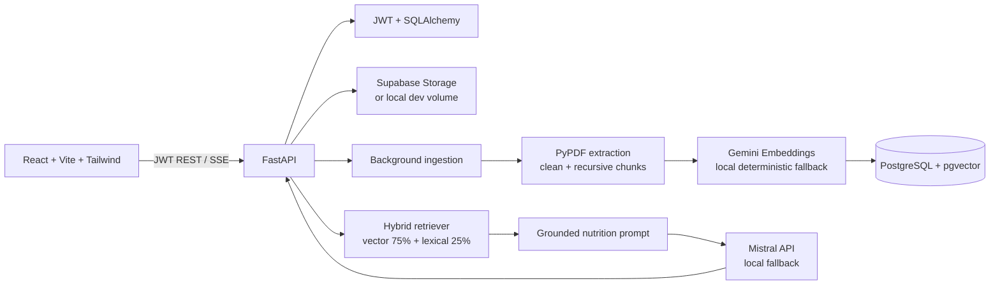

# NutriLens — Nutrition RAG Agent

NutriLens is a production-minded, document-grounded nutrition assistant. Users upload PDF research, guidelines, or meal-planning material, the backend extracts and indexes it, and chat answers are generated only from the retrieved passages with filename/page citations.

The project runs in two modes:

- `docker compose up` starts a local pgvector PostgreSQL database, FastAPI API, and Nginx-served React application.
- A Supabase deployment uses the same SQLAlchemy application with Supabase PostgreSQL and Supabase Storage by setting the remote credentials in `.env`.

## Architecture



## Stack

- Frontend: React 18, Vite, TypeScript, TailwindCSS, shadcn-style primitives, React Query, Axios, React Markdown.
- Backend: Python 3.11, FastAPI, Pydantic v2, SQLAlchemy 2, PyPDF, HTTPX.
- AI: Mistral chat completions and Gemini `embedContent` behind small provider interfaces.
- Data: PostgreSQL with `pgvector`; SQLite JSON embeddings are available for local unit tests. Supabase Storage is optional when running locally.

## Quick start with Docker

```bash
cp .env.example .env
# Add MISTRAL_API_KEY and GEMINI_API_KEY for real model responses.
docker compose up --build
```

Open [http://localhost:5173](http://localhost:5173). The API and Swagger UI are available at [http://localhost:8000/docs](http://localhost:8000/docs), with a health check at `/health`.

The local compose database is a pgvector image and persists to the `postgres_data` volume. Uploaded files use `backend_storage` unless Supabase Storage credentials are configured.

## Local development without Docker

The backend can use SQLite and deterministic local embeddings/local generation when API keys are absent:

```bash
cd backend
python3.11 -m venv .venv
source .venv/bin/activate
pip install -r requirements.txt
uvicorn app.main:app --reload
```

In another shell:

```bash
cd frontend
npm install
npm run dev
```

For local SQLite, set `DATABASE_URL=sqlite:///./nutrition_rag.db` in `.env`. For Supabase, set `DATABASE_URL` to the SQLAlchemy connection string, run `CREATE EXTENSION vector` in the Supabase SQL editor, and provide `SUPABASE_URL` plus `SUPABASE_SERVICE_KEY` (server-side only; never expose the service key to Vite).

## Request flow

1. `POST /api/auth/signup` or `POST /api/auth/login` returns a JWT.
2. `POST /api/upload` validates a PDF, extracts basic metadata, stores the bytes, and queues ingestion.
3. Ingestion cleans page text, removes repeated lines, keeps page boundaries, recursively chunks at 1,000 characters with 200-character overlap, embeds each chunk, and writes metadata plus the vector.
4. `POST /api/chat` embeds the question, filters to the authenticated user's chunks, combines vector cosine similarity and token overlap, and retrieves the top K (default 5).
5. The prompt instructs Mistral to answer only from those chunks. Responses include citation objects and the UI renders source chips after the answer.

Scanned/image-only PDFs are rejected with a clear OCR-required message. OCR can be added before `extract_pdf` using a managed OCR service or a worker such as Tesseract; it is intentionally not silently guessed.

## API reference

All application routes are under `/api`; FastAPI also exposes `/docs`, `/redoc`, and `/openapi.json`.

| Method | Endpoint | Purpose |
|---|---|---|
| POST | `/api/auth/signup` | Create an account |
| POST | `/api/auth/login` | Issue a JWT |
| GET | `/api/auth/me` | Current user |
| POST | `/api/upload` | Upload and queue a PDF |
| POST | `/api/ingest` | Queue ingestion using `{ "document_id": "..." }` |
| POST | `/api/ingest/{id}` | Queue one document |
| GET | `/api/documents?page=1&page_size=20` | Paginated user's documents |
| PUT | `/api/documents/{id}` | Rename/update source metadata |
| DELETE | `/api/documents/{id}` | Delete file and chunks |
| GET | `/api/documents/stats/summary` | Dashboard counts and recent files |
| POST | `/api/chat` | Answer from indexed context; set `stream: true` for SSE |
| GET | `/api/history` | Conversation and message history |
| DELETE | `/api/history/{id}` | Clear one conversation |
| GET/PUT | `/api/settings` | Retrieval and generation settings |
| GET | `/api/health` or `/health` | Database/application health |

Example chat request:

```json
{
  "question": "What does the uploaded guideline say about fiber?",
  "conversation_id": null,
  "stream": false
}
```

## Configuration

Copy `.env.example` to `.env`. Important values:

- `SECRET_KEY`: long random value in production.
- `DATABASE_URL`: `postgresql+psycopg://...` for PostgreSQL or SQLite for development.
- `MISTRAL_API_KEY`, `MISTRAL_MODEL`, `MISTRAL_BASE_URL`.
- `GEMINI_API_KEY`, `EMBEDDING_MODEL`, `EMBEDDING_DIMENSIONS`.
- `CHUNK_SIZE`, `CHUNK_OVERLAP`, `TOP_K`, `TEMPERATURE`.
- `SUPABASE_URL`, `SUPABASE_SERVICE_KEY`, and `SUPABASE_STORAGE_BUCKET` for remote PDF storage.

The server does not send secrets to the browser. `VITE_API_URL` is the only frontend runtime setting and should point at the public API URL.

## Folder structure

```text
nutrition-rag/
├── backend/
│   ├── app/
│   │   ├── api/          # auth, documents, chat, health routes
│   │   ├── database/     # SQLAlchemy engine and declarative base
│   │   ├── embeddings/   # Gemini interface + local fallback
│   │   ├── llm/          # Mistral interface + local fallback
│   │   ├── models/       # SQLAlchemy entities and Pydantic schemas
│   │   ├── prompts/      # grounded nutrition prompt
│   │   ├── rag/          # hybrid ranking primitives
│   │   ├── services/     # storage, PDF, ingestion, retrieval, chat
│   │   └── utils/        # logging, retry, rate limit
│   ├── ingest.py
│   ├── requirements.txt
│   └── tests/
├── frontend/
│   ├── src/components/   # layout, route guard, UI primitives
│   ├── src/pages/        # auth, dashboard, documents, chat, settings
│   └── Dockerfile
├── supabase/init.sql
├── docker-compose.yml
├── .env.example
└── README.md
```

## Testing

```bash
cd backend
pytest -q
```

The tests cover signup/login/JWT protection, health, and recursive chunking. API integrations are isolated behind provider interfaces so provider failures can be tested with fakes without network calls.

## Production deployment checklist

1. Use a managed Supabase/Postgres connection pooler and run the vector extension migration.
2. Replace the development secret, set `ENVIRONMENT=production`, restrict `CORS_ORIGINS`, and keep the Supabase service key server-side.
3. Put the API behind TLS and a reverse proxy/API gateway. The built-in limiter is single-process; use Redis or the gateway limiter when horizontally scaling.
4. Move background ingestion to a durable worker queue (Celery, Dramatiq, or a managed queue) if uploads must survive process restarts.
5. Configure structured log collection, provider timeouts/alerts, database backups, object retention, and malware scanning for uploaded PDFs.
6. Add an OCR branch for scanned documents if the source corpus requires it.
